<p align="center">
  <picture>
    <source media="(prefers-color-scheme: dark)" srcset="docs/assets/dark/hero.svg">
    
  </picture>
</p>

<p align="center">
  <a href="#run-it"><picture>
    <source media="(prefers-color-scheme: dark)" srcset="docs/assets/dark/link-run.svg">
    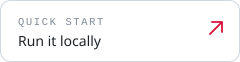
  </picture></a>
  <a href="#go-live"><picture>
    <source media="(prefers-color-scheme: dark)" srcset="docs/assets/dark/link-live.svg">
    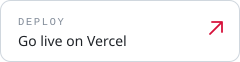
  </picture></a>
  <a href="#running-the-shop"><picture>
    <source media="(prefers-color-scheme: dark)" srcset="docs/assets/dark/link-ops.svg">
    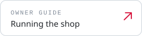
  </picture></a>
  <a href="#what-is-and-is-not-verified"><picture>
    <source media="(prefers-color-scheme: dark)" srcset="docs/assets/dark/link-honest.svg">
    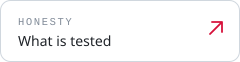
  </picture></a>
</p>

<p align="center">
  <picture>
    <source media="(prefers-color-scheme: dark)" srcset="docs/assets/dark/intro.svg">
    
  </picture>
</p>

<p align="center">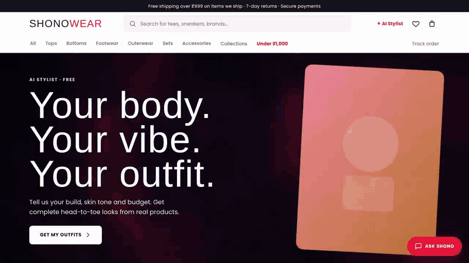</p>
<p align="center"><sub>A recording of the real shop. Photos are placeholders. Full-quality WebM: <a href="docs/media/tour.webm">tour</a> · <a href="docs/media/banner.webm">3D banner</a>.</sub></p>

<p align="center">
  <picture>
    <source media="(prefers-color-scheme: dark)" srcset="docs/assets/dark/h-glance.svg">
    
  </picture>
</p>

<p align="center">
  <picture>
    <source media="(prefers-color-scheme: dark)" srcset="docs/assets/dark/stats.svg">
    
  </picture>
</p>

<p align="center">
  <picture>
    <source media="(prefers-color-scheme: dark)" srcset="docs/assets/dark/h-features.svg">
    
  </picture>
</p>

<p align="center">
  <picture>
    <source media="(prefers-color-scheme: dark)" srcset="docs/assets/dark/f-checkout.svg">
    
  </picture>
  <picture>
    <source media="(prefers-color-scheme: dark)" srcset="docs/assets/dark/f-size.svg">
    
  </picture>
  <picture>
    <source media="(prefers-color-scheme: dark)" srcset="docs/assets/dark/f-waitlist.svg">
    
  </picture>
  <picture>
    <source media="(prefers-color-scheme: dark)" srcset="docs/assets/dark/f-bundle.svg">
    
  </picture>
  <picture>
    <source media="(prefers-color-scheme: dark)" srcset="docs/assets/dark/f-assistant.svg">
    
  </picture>
  <picture>
    <source media="(prefers-color-scheme: dark)" srcset="docs/assets/dark/f-admin.svg">
    
  </picture>
</p>

<p align="center">
  <picture>
    <source media="(prefers-color-scheme: dark)" srcset="docs/assets/dark/h-more.svg">
    
  </picture>
</p>

<p align="center">
  <picture>
    <source media="(prefers-color-scheme: dark)" srcset="docs/assets/dark/m-pin.svg">
    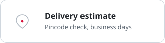
  </picture>
  <picture>
    <source media="(prefers-color-scheme: dark)" srcset="docs/assets/dark/m-3d.svg">
    
  </picture>
  <picture>
    <source media="(prefers-color-scheme: dark)" srcset="docs/assets/dark/m-wish.svg">
    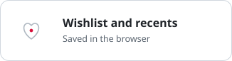
  </picture>
  <picture>
    <source media="(prefers-color-scheme: dark)" srcset="docs/assets/dark/m-track.svg">
    
  </picture>
  <picture>
    <source media="(prefers-color-scheme: dark)" srcset="docs/assets/dark/m-tabs.svg">
    
  </picture>
  <picture>
    <source media="(prefers-color-scheme: dark)" srcset="docs/assets/dark/m-legal.svg">
    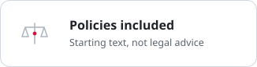
  </picture>
</p>

<p align="center">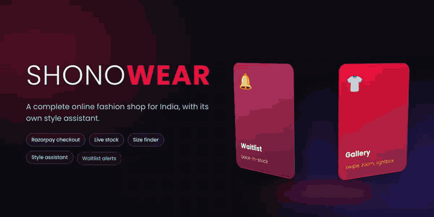</p>

<p align="center">
  <picture>
    <source media="(prefers-color-scheme: dark)" srcset="docs/assets/dark/h-stack.svg">
    
  </picture>
</p>

<p align="center">
  <picture>
    <source media="(prefers-color-scheme: dark)" srcset="docs/assets/dark/stack.svg">
    
  </picture>
</p>


Two kinds of products live side by side in `src/data/catalog.js`:

| Kind | How it sells | Fields |
|---|---|---|
| **Own stock** | Customer pays you on this site; you ship it. | `fulfilment: 'own'`, `platform: 'Shonowear'`, `sizes: { M: 8, L: 5 }`, no `affiliateUrl` |
| **Affiliate** | "Buy" opens Amazon/Myntra through your affiliate link; you earn a commission. | `affiliateUrl`, `platform` |

No fake ratings or discounts are shown. The strike-through price appears only if you add a real `mrp` to a product.


<p align="center">
  <picture>
    <source media="(prefers-color-scheme: dark)" srcset="docs/assets/dark/h-run.svg">
    
  </picture>
</p>

Needs Node 20 or newer. Commands are written for fish; in bash use `&&` instead of `; and`.

```fish
npm install
npm run dev                  # website only (checkout needs the API)
cp .env.example .env.local   # fill in Razorpay TEST keys; Upstash is optional locally
npm run build; and npm run dev:api   # site + API on http://localhost:8787 (in-memory store without Upstash)
npm run verify               # tests + catalogue check + build
```

Browser tests (need `npm i -D playwright` and `npx playwright install chromium`): `npm run e2e`.


<p align="center">
  <picture>
    <source media="(prefers-color-scheme: dark)" srcset="docs/assets/dark/h-live.svg">
    
  </picture>
</p>

1. **Fill `src/data/storeConfig.js`**: legal name, address, support email/phone, GSTIN, shipping fee and times, return days, bundle discount.
2. **Catalogue**: delete the `[SAMPLE]` products, add your own with real photos (put images in `public/`), real prices and per-size stock. Replace the placeholder Amazon tag `shonowear-21` with your Associates tag. Add `public/og-image.jpg` (1200×630).
3. `npm run check:launch` must pass. It fails on samples, placeholders and the placeholder tag.
4. **Accounts**
   - **Upstash**: create a Redis database (region near you), copy the REST URL and token.
   - **Razorpay**: finish KYC. Start with **Test mode** keys. In *Settings → Payment capture* keep **auto-capture on** (the site treats a verified payment as paid).
   - **Resend**: verify your sending domain.
5. **Vercel**: import the repo, add every variable from `.env.example`, deploy. Vercel's free Hobby plan is for non-commercial use, so check Vercel's terms and use a paid plan for a real business. This project uses 10 of Hobby's 12 functions.
6. **Webhook**: Razorpay Dashboard → Webhooks → URL `https://YOUR-DOMAIN/api/razorpay-webhook`, events `payment.captured` and `order.paid`, secret = `RAZORPAY_WEBHOOK_SECRET`. It confirms orders when a customer closes the tab after paying.

### Test-mode checklist (do all of it)
- [ ] Pay with a Razorpay test UPI/card. The order page shows "Thank you"; you and the customer get emails.
- [ ] Close the popup mid-payment: stock is released, the bag is kept.
- [ ] Pay, then close the tab before the redirect: the webhook still marks the order paid (Razorpay Dashboard → Webhooks shows 200).
- [ ] `/admin`: enter your token, mark an order shipped with a tracking number; the customer's order page shows it.
- [ ] Browser console on `/checkout` shows no CSP errors while the popup opens.
- [ ] Only then switch to **live keys**. Samples are refused under live keys as a safety net.


<p align="center">
  <picture>
    <source media="(prefers-color-scheme: dark)" srcset="docs/assets/dark/h-ops.svg">
    
  </picture>
</p>

- **Orders**: `/admin` (token kept in memory only). Orders flagged `paid-after-hold-expired`, `paid-after-cancel` or `oversold-needs-review` need a human decision: ship, or refund.
- **Refunds** are manual in the Razorpay dashboard. Cancelling a paid order in `/admin` does **not** refund the customer and does **not** restock.
- **Stock** comes from the catalogue file. Changing it means editing `catalog.js` and redeploying. Units already sold are tracked separately in Redis, so editing totals is safe.
- **Stock holds**: 15 minutes while paying, one open hold per visitor. Someone with many IPs could still tie up stock briefly; watch for abandoned orders.
- **Emails are best-effort.** If Resend is down, the order is still recorded; the admin page is the source of truth.
- Order links are unguessable 96-bit tokens; the public page hides phone, email and street address.

### Shopping features
- **Gallery**: add `images: [url, url, ...]` to a product. Swipe on phones, hover-zoom and a full-screen viewer on desktop.
- **Size guide**: set `sizeChart: 'tops' | 'bottoms' | 'footwear'` or your own `{title, columns, rows}`. The built-in charts are generic. **Replace them with your real measurements** before launch. "Find my size" is an estimate.
- **Colour variants**: give products of the same design the same `colorGroup`; swatches link between them.
- **Bundle discount**: buying 2 or more own-stock items takes 10% off, calculated on the server. Edit or disable it (`percent: 0`) in `storeConfig.js`.
- **Delivery estimate**: business-day estimate from the pincode using `deliveryDays`. It is not a courier serviceability check; connect a courier API later for exact dates.
- **Back-in-stock and low-stock alerts**: customers sign up on sold-out sizes. Open `/admin` to see the waitlist and send alerts (only for sizes that are back in stock). A low-stock email goes to you when a size falls to `lowStockThreshold`. Both need Resend configured.
- **Collections, filters, quick view, recently viewed, "New" badge** (`addedAt`, 30 days) work from catalogue data with no setup.
- **Coupons**: edit `server/couponsConfig.js` (server only: percent or flat, minimum, cap, dates, usage limit, once per customer, first order only). `WELCOME10` and `FLAT150` are **samples**: delete them (live mode refuses them and `npm run check:launch` fails until you do). By default a coupon and the bundle discount do not stack; the customer gets the bigger one.
- **Flash sales**: edit `src/data/offers.js` (percent 5-80, start and end in India time, chosen products). The server prices the order, so a sale ends exactly on time. Sale items skip bundle and coupon discounts (`stackOnSale`). Remove the sample sale before launch.
- **Cash on delivery**: `STORE.cod` (fee ₹49, limit ₹5,000, max 2 open orders per phone, blocked pincode prefixes). Not combinable with gift cards or pre-orders. Mark "Cash collected", "Delivered" or "Cancelled/refused" in `/admin`; a cancel puts the stock back. Refused parcels cost you shipping: keep the limit low at first.
- **Gift cards**: customers buy them at `/gift-cards`; you can issue them in `/admin`. 12-month validity, store-only, code shown only after payment. A card that covers the whole order needs no Razorpay. Ask an accountant how GST applies to vouchers.
- **Referrals**: after an order, the customer gets a share code. The friend gets ₹100 off a first order of ₹999 or more; the referrer gets a ₹100 gift card when that order is marked delivered (once, capped).
- **Bag reminder**: opt-in at checkout, stored 7 days, **one** email sent from an admin button, then deleted. Mention consent in your privacy text (done) and respect unsubscribe requests.
- **Pre-orders**: add `preorder: { shipsOn: 'YYYY-MM-DD' }` to an own product. Prepaid only; the order shows the ship date.
- **Saved addresses**: kept in the customer's browser only.
- **Dashboard** (`/admin`): orders, revenue after refunds, average order, cash still to collect, a 30-day chart, best sellers and sizes running low. Built from your last 1,000 orders.
- **Edit price and stock in the browser** (`/admin` → Price and stock): changes apply at once, layered over `catalog.js` (stored in Upstash, so it needs the database). "Available" means what customers can buy now. "Reset to file" undoes an edit. You can only edit existing sizes of products you ship; **new products and sizes** go in `catalog.js`, or use the CSV script below. Other server instances can lag up to 10 seconds, but checkout always reads the latest edit.
- **Spreadsheet bulk edit**: download current prices and stock as CSV, edit, upload (columns id, size, stock, price, mrp). It checks the whole file first and applies nothing if any line is wrong.
- **Add many new products from a spreadsheet**: write a CSV (id, name, category, price, image, sizes like `S:5|M:10`, tags; optional mrp, images, brand, colorGroup, sizeChart, preorder, explanation), run `npm run import:products -- products.csv`, then `npm run verify` and redeploy. Photos must be web addresses of images you own: there is no image upload, because that needs paid storage.
- **Refund button**: "Refund…" on an online order calls Razorpay for you. It never refunds more than was charged online, one at a time per order, and every refund is logged before anything else. From a return request you can refund and close the request in one click. Cash on delivery orders and gift-card money are not refunded by this button: pay those yourself.
- **GST invoices and packing slips**: "Invoice" and "Packing slip" open printable pages. Invoice numbers are sequential per financial year (`SW/2026-27/0001`) and never change. **Tax lines appear only when you set `gstin` in `storeConfig.js`.** The rates (5% up to ₹2,500 per piece, 18% above), the HSN codes and the CGST/SGST/IGST split are starting values: **have your accountant confirm them before you give a customer a real invoice.** Without a GSTIN you get a plain invoice with no tax.
- **Customers and offer emails**: the customer list is built from paid orders. Offer emails go only to people who ticked "Email me new drops and offers" at checkout, each with an unsubscribe link and your business address. One campaign per 10 minutes, 200 people at most. Send yourself a test first.
- **Customer accounts** (`/account`): passwordless. The customer enters an email, we send a one-time link (15 minutes), and a 30-day HttpOnly cookie keeps them signed in. **This needs Resend and `SITE_URL` set**, otherwise nobody can sign in on the live site. They see their orders (matched by email), tracking, and can request returns. Orders placed before this feature was installed are not listed.
- **Reviews**: only customers whose order you marked **Delivered** can review, once per product. Each review waits for your approval in `/admin` (`reviews.moderate` in `storeConfig.js`). The page shows only real, approved reviews and a real average: there are no placeholder ratings.
- **Product questions**: signed-in customers ask; you answer in `/admin`; only answered questions are public.
- **Returns and exchanges**: inside `returnDays` of the delivered date. You approve, mark received, then mark refunded (you enter the amount) or exchange sent; the customer gets an email at each step. **It records and emails: it does not move money.** Refund in the Razorpay dashboard (or by UPI/bank for cash on delivery), and fix your stock by hand.
- **Shipping emails and tracking**: marking an order shipped or delivered emails the customer; the order page links to the courier's own tracking page for Delhivery, Blue Dart, DTDC, India Post, Ecom Express, Xpressbees and Shiprocket (type the courier name as shown, plus the tracking number). Live tracking inside the site needs a paid aggregator API and is not included.
- **WhatsApp**: set `whatsapp` in `storeConfig.js` (country code, digits only) for a "Chat with us on WhatsApp" button on the order and contact pages. Automatic WhatsApp messages need the paid WhatsApp Business API and are not included.
- **Journal, About, FAQ and Care pages**: the text lives in `src/data/posts.js` and `src/data/pages.js` (a small safe markdown: `##` headings, `-` lists, `**bold**`, https or `/path` links only). The three starter posts and the FAQ are **generic starting text: replace them with your own** (real delivery times, real policies) before launch. Each post gets its own page, search data and preview.
- **Instagram strip** (`src/data/instagram.js`): set your `handle` and list up to a few posts (post link and image) and a grid appears on the home page. It is a hand-picked grid, **not a live feed** (a live feed needs Meta's API and an app review). Images must be https and, because of the Content-Security-Policy, hosted on `images.unsplash.com` or on your own site (add other hosts in `vercel.json` `img-src`).
- **Search and link previews**: `npm run build` writes a ready-made HTML file for each public URL (53 today) with the right title, description, preview image, canonical link and Product / Article / FAQ data, so WhatsApp, Instagram and Google see the right thing without running JavaScript. **Set `SITE_URL` (for example `https://yourdomain.com`) in Vercel**, otherwise preview links stay relative and WhatsApp will not show the picture. It also writes `sitemap.xml` and `robots.txt`. Only the page head and a plain-text summary are pre-rendered; the shop itself is still the normal app. Private pages (admin, orders, bag, account) are marked `noindex`.
- **Icons and preview image**: `node scripts/make-icons.mjs` draws the app icons and `og-image.jpg` from a simple "SW" mark. Replace the mark in that script (or the PNG/JPG files in `public/`) with your real logo.
- **Visit counters** (admin Dashboard → Visits): first-party and cookieless. Page views by section, product views, adds to bag, checkouts started, stylist uses, email sign-ups, buy clicks on affiliate items. It stores only counts per day, **no IP, no id, no cookie**, so there is no "unique visitors" number by design. Do Not Track and Global Privacy Control are respected. It replaced the Vercel Analytics script. Because it counts events and not people, treat the funnel percentages as rough.
- **Privacy notice**: a short one-time notice, not a consent wall, because nothing here needs consent today (the sign-in cookie is strictly necessary and the counters are anonymous). If you later add an ad pixel or any third-party tracker, load it only when `hasConsent('marketing')` (in `PrivacyNotice.jsx`) is true and build a real choice first. Check this with whoever advises you on the DPDP Act.
- **Install as an app**: a web manifest, an offline page and a small service worker, plus an "Install the app" button in the footer (iPhone gets the Add to Home Screen steps). The worker caches only static files, never pages, prices, stock, `/api`, checkout, orders, account or admin. Each build gets a new cache name.
- **Hindi**: an English / हिन्दी switch in the header, remembered per device. It covers the menu, tab bar, footer, home headings, shop, product buttons, bag and the checkout field labels (`src/i18n/hi.js`). **The policy pages, blog, FAQ and the rest of checkout stay English**, and **a native Hindi speaker should review the wording**. Strings with no Hindi entry fall back to English; a test fails if code uses a string that has no entry.
- **Brand and logo** (`src/brand/mark.js`, `src/components/Logo.jsx`): a simple "S" mark (white top, red bottom) with the SHONOWEAR wordmark. It is a **placeholder you should replace with your real logo**: edit `src/brand/mark.js` (or the `Logo` component) and run `node scripts/make-icons.mjs` to regenerate the favicon, app icons and the link-preview image from the same source. If you already have a logo, replace the files in `public/` (`favicon.svg`, `og-image.jpg`, `icons/*`) and the `Logo` component. Check that you are allowed to use the name and mark (trademark search) before spending on branding.
- **Fonts are served from your own site** (`@fontsource` packages, pinned): no Google Fonts request, so faster first load, no third party seeing your visitors, and a tighter Content-Security-Policy (`font-src 'self'`). Poppins (including the ₹ sign), Bebas Neue, DM Serif Display and Noto Sans Devanagari for Hindi. Each page only downloads the font files it needs.
- **Motion**: pages fade in, sections on the home page and the looks grid reveal as you scroll, look cards lean toward a mouse pointer, and the bag count bumps when you add something. **Everything switches off for people who set "reduce motion"**, nothing is hidden before the script runs, and touch screens get no tilt.
- **3D**: the brand mark in 3D (Three.js, loaded only when needed) on the About and 404 pages, next to the existing hero background. It shows the flat logo first and keeps it when WebGL is missing, data-saver is on or motion is reduced. It pauses off-screen and frees its GPU memory when you leave the page. Three.js is never part of the main download.
- **Shop the look** (`/looks`, `/looks/<slug>`): curated outfits from `src/data/looks.js` (product ids; edit freely). Each look shows its pieces with size pickers and the honest price: pieces we ship are totalled with the real sale and bundle-discount rules, partner (Amazon/Myntra) pieces are summed separately and link out, never mixed into our total. "Add to bag" is all or nothing: if a size is missing or sold out, nothing is added and the page says which piece to fix. Product pages link to the looks they appear in, and three looks show on the home page. Looks that lose products (for example when you delete the samples) hide themselves; `npm run check:launch` warns about dead ids.
- **Build your look** (`/build`): pick a top, bottom, layer, shoes and extra from the catalogue; the choice lives in the web address (`?top=<id>&bottom=<id>`), so a look can be shared by link, and the address is checked against the catalogue (wrong or unknown ids are ignored). Looks can be saved on the device ("My looks", ids only, up to 20). The new pages are in English and not part of the Hindi switch.
- **Not built (your choice): real AI chat and photo style analysis.** They need an Anthropic API key and a paid per-use bill; the current stylist is rule-based and free.


<p align="center">
  <picture>
    <source media="(prefers-color-scheme: dark)" srcset="docs/assets/dark/h-honest.svg">
    
  </picture>
</p>

- **Tested here (309 unit/integration tests and 211 browser checks):** price computed on the server, forged payment signatures rejected, overselling prevented, holds expire, webhook idempotency, crash recovery, customer privacy, admin throttling, bundle discount, size finder, waitlist, mobile layout. Razorpay itself was **simulated** (a fake order API and a stubbed checkout popup that signs payments the way Razorpay does).
- **Not verified, because it can't be from here:** a real Razorpay payment, real webhook delivery to Vercel, the exact domains Razorpay's popup needs under the Content-Security-Policy, and Vercel's header behaviour. **Do the test-mode checklist before going live.** If the payment popup is blocked, open the browser console, look for a "Refused to ..." CSP message and add that domain in `vercel.json`.
- **Not legal advice.** The policy pages are starting text, not reviewed by a lawyer. Selling goods needs a business registration, and GST registration and invoicing if you cross the threshold or sell inter-state through marketplaces. Check with an accountant and a lawyer.

- **Monitoring**: point a free uptime monitor (e.g. UptimeRobot) at `https://YOUR-SITE/api/config?health=1`. It answers 200 when the database is reachable and 503 when not, with yes/no flags only (no secrets). Server errors and browser crashes are collected (personal data like emails is masked) and listed under "Recent problems" at the top of `/admin`. Payment-critical failures email the owner (needs `ORDER_NOTIFY_EMAIL` + Resend), at most once an hour per kind. In serverless this capture is best-effort.
- **Backups**: set `BACKUP_PASSPHRASE` (12+ characters) and `CRON_SECRET` (16+ characters) in Vercel. A daily job (21:30 UTC) emails an **encrypted** backup (AES-256-GCM) to the owner; backups hold customer data, which is why they are never sent unencrypted. `/admin` has "Download a backup" (limit 3MB). For anything bigger: `node --env-file=.env scripts/backup.mjs`, and restore with `node --env-file=.env scripts/restore.mjs <file> --yes` (add `--force` only to overwrite a non-empty database). `backups/` is git-ignored. Test a restore once on a spare database before you trust it. The email attachment and the cron were not tested against real Resend/Vercel.
- **Images**: put your original photos in `photos/` and run `npm run photos`. It makes 480/800/1200px WebP versions (plus a JPEG fallback) in `public/p/`, strips location/EXIF data and crops to 4:5. Then use `/p/name.jpg` as the product image. Pages request the size that fits the screen and lazy-load everything except the first image.
- **Accessibility**: an automated axe scan (WCAG 2.0/2.1 A and AA) runs in `npm run e2e` over 12 pages in light and dark, phone and desktop, and finds no violations. Also checked: skip link, focus rings, Escape closes dialogs, one heading level-1 per page, 320px width without sideways scrolling. Red text uses a darker `--red-text` token so it stays readable. Automated tools catch only part of the problems: do one pass with a real screen reader (NVDA or VoiceOver) and keyboard-only before launch.
- **Env vars** added: `CRON_SECRET`, `BACKUP_PASSPHRASE`, `ORDER_NOTIFY_EMAIL`.

### Known limits
- `npm audit` reports a moderate react-router 6 advisory (open redirect via backslash in `<Link>`). The site never passes user input to links or `navigate`, so it isn't reachable here; upgrading to v7 is a later job.
- The `/admin` order list shows the latest 200 orders (Redis keeps 1,000).
- Product images from Unsplash are placeholders; use your own photos.
- The assistant is keyword-based and says so when it doesn't understand.
- No marketplace (Amazon, Myntra) stock sync; those items are affiliate links only.


<p align="center">
  <picture>
    <source media="(prefers-color-scheme: dark)" srcset="docs/assets/dark/h-road.svg">
    
  </picture>
</p>

<p align="center">
  <picture>
    <source media="(prefers-color-scheme: dark)" srcset="docs/assets/dark/roadmap.svg">
    
  </picture>
</p>

<details>
<summary>Plain-text version</summary>

Shonowear is an online fashion shop for India. Customers pay through Razorpay; stock, prices and orders are checked on the server, and a rule-based style assistant is built in. It sells your own stock and affiliate products side by side. Stack: React 18, Vite 5, React Router 6, Three.js, Vercel serverless functions, Upstash Redis, Razorpay and Resend, tested with Vitest and Playwright.

Features: photo gallery, size guide and size finder, colour variants, quick view, filters, collections, bundle discount, pincode delivery estimate, back-in-stock and low-stock alerts, wishlist, order tracking and an admin page.

Roadmap: A shopping experience (shipped); B selling tools; C customers; D back office; E to H content, AI, polish and reliability (planned).

</details>

<sub>Panels are generated by `node scripts/build-readme-art.mjs`; the recordings by `node scripts/record-media.mjs` (needs ffmpeg).</sub>
